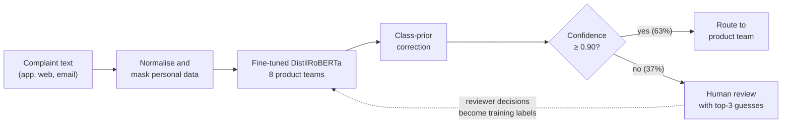
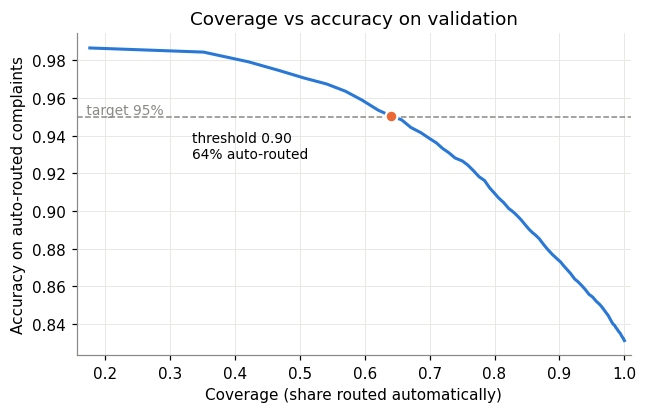
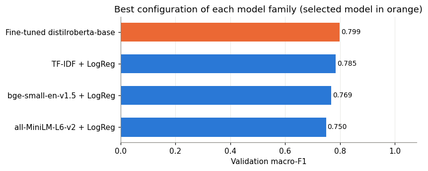
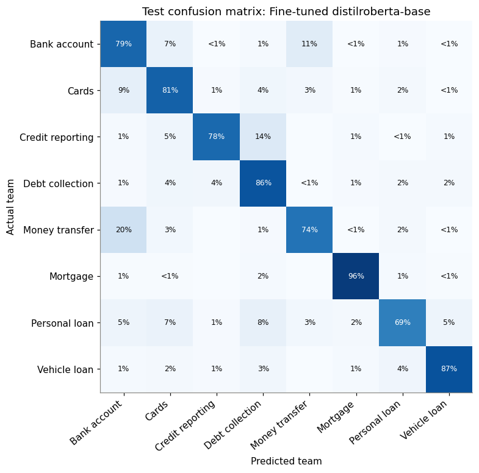
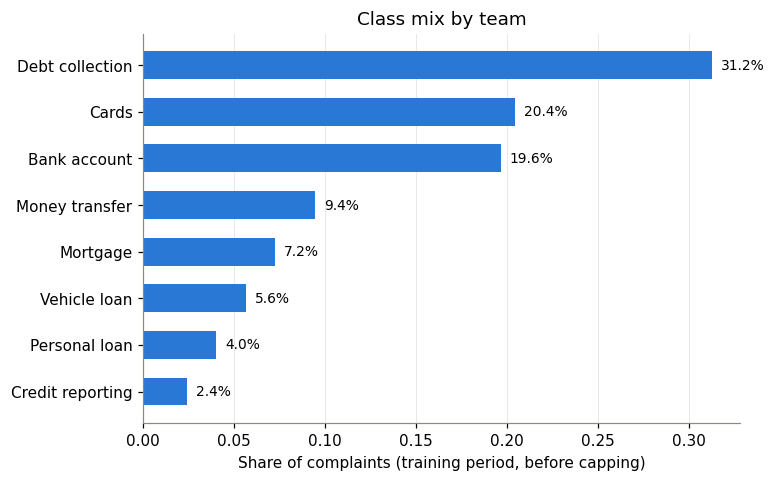
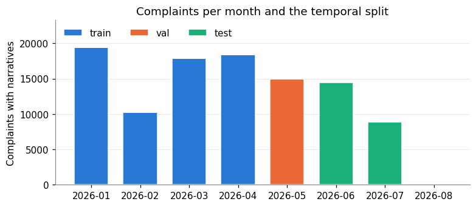
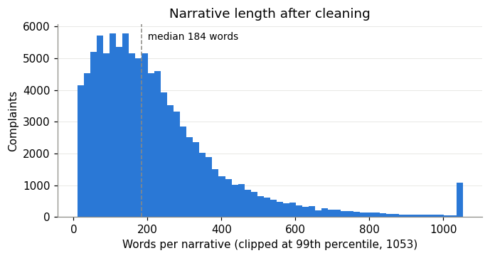

<!--
  README for MAAI902_UAE_Complaint_Triage-Project
  ------------------------------------------------
  Maintainer notes (not shown on GitHub):
  - All figures and numbers come from the recorded run saved in
    uae_complaint_triage(1).ipynb (Tesla T4, seed 42). If you re-run the
    notebook and the numbers change, update the "Results" sections below.
  - Images are loaded from ./figures/ and the report from ./report/.
    Keep those folder names, or update the paths in this file.
  - The notebook file name contains brackets, so links to it use %28 and %29.
-->

# AI-Assisted Complaint Triage for UAE Banks

**Lexical and Transformer Models for UAE Bank Complaint Triage**
*Evidence from consumer complaint narratives and selective routing*

[](https://colab.research.google.com/github/MambaMan420/MAAI902_UAE_Complaint_Triage-Project/blob/main/uae_complaint_triage%281%29.ipynb)


An NLP prototype that reads a bank customer's free-text complaint, masks personal data, predicts which of **eight product teams** should handle it, and sends low-confidence cases to a **human reviewer** instead of routing them automatically.

> **Headline result:** on 12,000 unseen complaints, a fine-tuned DistilRoBERTa routed **63.3%** of complaints automatically at **94.8%** accuracy and referred the remaining **36.7%** to human review. Overall accuracy across all complaints was **82.2%** (macro-F1 **0.794**).

Course project for **MAAI902 – Natural Language Processing and LLMs** (Assessment Task 2: NLP Solution Design), University of Wollongong in Dubai.

---

## Table of contents

1. [The problem](#1-the-problem)
2. [Results at a glance](#2-results-at-a-glance)
3. [How the system works](#3-how-the-system-works)
4. [Dataset](#4-dataset)
5. [Pre-processing](#5-pre-processing)
6. [Train, validation and test split](#6-train-validation-and-test-split)
7. [Models and hyperparameters](#7-models-and-hyperparameters)
8. [Human-review threshold](#8-human-review-threshold)
9. [Detailed results](#9-detailed-results)
10. [Responsible AI checks](#10-responsible-ai-checks)
11. [Gradio demo](#11-gradio-demo)
12. [How to run](#12-how-to-run)
13. [Repository structure](#13-repository-structure)
14. [Limitations and future work](#14-limitations-and-future-work)
15. [References](#15-references)
16. [Author](#16-author)

---

## 1. The problem

Banks receive complaints as free text through apps, web forms and email. Before anyone can investigate, a member of staff has to read each complaint and decide which team owns it: cards, accounts, transfers, loans and so on. A complaint sent to the wrong team is passed around, and every hand-off costs time.

In the UAE that time is regulated. The Central Bank of the UAE **Consumer Protection Standards** (Article 8) require banks to:

| Requirement | Limit |
|---|---|
| Acknowledge a complaint in writing | within **2** complete business days |
| Send a final written response | within **30** complete business days |
| Report complaint volumes and types | to senior management |

Customers who are not satisfied can escalate to **Sanadak**, the UAE financial ombudsman.

This project treats first-line routing as a **supervised text classification** problem with **selective prediction**: the model routes a complaint automatically only when it is confident, and refers everything else to a person.

> The 95% accuracy and 50% coverage targets used here are experimental design objectives, not regulatory requirements. Classifier accuracy alone does not demonstrate regulatory compliance or shorter resolution times.

---

## 2. Results at a glance

| Measure (test set, 12,000 complaints, June–August 2026) | Value |
|---|---|
| Selected model | Fine-tuned `distilroberta-base` |
| Accuracy, all complaints | **82.22%** |
| Macro-F1 | **0.7941** |
| Weighted F1 | 0.8237 |
| Review threshold (chosen on validation) | **0.90** |
| Complaints routed automatically | **63.27%** (7,592) |
| Accuracy on automatically routed complaints | **94.76%** (398 errors) |
| Complaints sent to human review | **36.73%** (4,408) |

**Key findings**

- Fine-tuning won, but only by about **1 point**: TF-IDF with logistic regression reached 81.30% accuracy and trains in about a minute.
- Frozen sentence embeddings (MiniLM, BGE-small) performed **worse** than the TF-IDF baseline.
- The human-review threshold met the coverage objective but missed the 95% accuracy target on the test months by about **0.24 percentage points**.
- On the curated BANKING77 benchmark used in an earlier pilot, the same design scored 92.5% accuracy. Real complaints are messier, which is exactly why human review matters.

---

## 3. How the system works



1. **Input validation.** Empty or very short inputs are rejected.
2. **Normalisation and masking.** Text is normalised and personal data is replaced with placeholders such as `[CARD_OR_ACCOUNT]`, `[IBAN]` and `[EMIRATES_ID]`, so the model never sees it.
3. **Prediction.** The classifier returns a probability for each of the eight teams.
4. **Class-prior correction.** Probabilities are re-weighted from the balanced training mix back to the real class mix.
5. **Confidence check.** If the top probability is at least 0.90 the complaint is routed automatically; otherwise it goes to a reviewer with the model's top three guesses.

The system decides **product ownership only**. It does not judge whether a complaint is valid, decide compensation or redress, or make decisions about creditworthiness or accounts. There is no generative LLM, retrieval system or automatic reply in this implementation.

---

## 4. Dataset

| Property | Value |
|---|---|
| Source | [CFPB Consumer Complaint Database narratives archive](https://www.consumerfinance.gov/foia-requests/foia-electronic-reading-room/cfpb-consumer-complaint-database-narratives-archive/) |
| Files | 7 archive zips covering January–August 2026 |
| Complaints with narratives | **121,394** (received 1 January to 11 August 2026) |
| Companies | about 2,362 |
| Mapped to 8 teams | **117,339** |
| After cleaning | **104,182** |

**Why this dataset.** The narratives are *organic*: each one was written by a real consumer about their own problem with a financial institution, the consumer chose the product category, and the CFPB published it only with the consumer's opt-in consent after removing personal details.

**Label mapping.** CFPB product categories are mapped to eight routing teams:

| Team | Complaints | CFPB products included |
|---|---:|---|
| Debt collection | 41,306 | Debt collection; Debt or credit management |
| Cards | 21,897 | Credit card; Prepaid card |
| Bank account | 21,335 | Checking or savings account |
| Money transfer | 9,807 | Money transfer, virtual currency, or money service |
| Mortgage | 7,772 | Mortgage |
| Vehicle loan | 5,921 | Vehicle loan or lease |
| Credit reporting | 4,945 | Credit reporting or other personal consumer reports |
| Personal loan | 4,356 | Payday loan, title loan, personal loan, or advance loan |

Student loans (4,055 complaints) are excluded because their US institutional context transfers poorly to UAE retail banking.

> **Data caveats.** The CFPB states that its complaints are not a statistically representative sample of consumer experiences, and allegations are not verified. The data is US-based and English-only. Raw narratives are **not** stored in this repository; the notebook downloads them from the source.

> **Note:** the CFPB stopped publishing narratives in its live database on 14 August 2026. Previously published narratives remain available in the FOIA Reading Room archive linked above.

---

## 5. Pre-processing

| Step | What it does | Result |
|---|---|---|
| Unicode normalisation | NFKC, control characters removed, whitespace standardised | Consistent text from web forms and keyboards |
| Privacy masking | CFPB redactions, amounts, dates, emails, URLs, phone numbers, IBANs, Emirates IDs and card/account numbers replaced with placeholders | `[REDACTED]` in 86.85% and `[AMOUNT]` in 45.78% of training narratives |
| Short-text filter | Narratives under 10 words removed | 319 removed |
| Duplicate removal | Fingerprint of lowercased letters only, earliest copy kept | **12,838** removed (47.6% of credit-reporting, 24.6% of debt-collection narratives) |

The **same cleaning function** is applied to training data and to live demo input, so the model always sees text in the same format.

**Deliberately not done:** stop-word removal and stemming, because negations such as "never received" carry meaning and transformer models need whole sentences. TF-IDF lowercases internally; transformer inputs keep their case.

Example of the masking (invented details):

```text
Before: My card 4111 1111 1111 1111 was charged {$250.00} on XX/XX/2026. Call me on +971 50 123 4567.
After:  My card [CARD_OR_ACCOUNT] was charged [AMOUNT] on [REDACTED]. Call me on [PHONE].
```

---

## 6. Train, validation and test split

The split is **chronological** (by date received), not random. The model is trained on the past and tested on the future, as it would be used in a bank, and drift such as new scams or a changing product mix is not hidden.

| Split | Period | Complaints used |
|---|---|---:|
| Training | 1 January – 30 April 2026 | **27,957** (of 65,943 available) |
| Validation | May 2026 | **8,000** (random sample) |
| Test | 1 June – 11 August 2026 | **12,000** (random sample) |

| Team | Training | Validation | Test |
|---|---:|---:|---:|
| Bank account | 4,000 | 1,637 | 2,735 |
| Cards | 4,000 | 1,676 | 2,559 |
| Credit reporting | 1,589 | 186 | 330 |
| Debt collection | 4,000 | 2,316 | 3,158 |
| Money transfer | 4,000 | 764 | 1,081 |
| Mortgage | 4,000 | 597 | 966 |
| Personal loan | 2,644 | 353 | 520 |
| Vehicle loan | 3,724 | 471 | 651 |
| **Total** | **27,957** | **8,000** | **12,000** |

- Training is **capped at 4,000 complaints per team** so the largest class does not dominate.
- Validation and test keep the **real class mix**, because review rates and accuracy must be measured on realistic traffic.
- Automated checks confirm that **no complaint ID or duplicate text appears in two splits**.

---

## 7. Models and hyperparameters

Four model families were compared. Every setting was chosen on the May validation month; the test months were evaluated once, at the end.

| Model | Representation | Classifier | Settings searched | Best |
|---|---|---|---|---|
| TF-IDF baseline | Word 1–2 grams, sublinear TF, `min_df=3`, `max_df=0.9`, 200,000 features | Logistic regression | C ∈ {0.5, 2, 8, 32} | C = 8 |
| MiniLM embeddings | `all-MiniLM-L6-v2`, 384-dim, first 256 tokens | Logistic regression | C ∈ {1, 10, 100} | C = 10 |
| BGE embeddings | `bge-small-en-v1.5`, 384-dim, first 512 tokens | Logistic regression | C ∈ {1, 10, 100} | C = 10 |
| **Fine-tuned transformer** | `distilroberta-base`, updated end to end | Classification head | see below | selected |

**Fine-tuning configuration**

| Setting | Value |
|---|---|
| Backbone | `distilroberta-base` (encoder and classification head trained end to end) |
| Input | 256 tokens: first 127 + last 127 tokens of each complaint (head + tail truncation) |
| Optimiser and loss | AdamW, cross-entropy, weight decay 0.01 (not on biases or layer norms) |
| Learning rate | 5e-5 with 6% linear warm-up, then linear decay |
| Epochs | 2 (about 874 steps each); best epoch kept by validation macro-F1 |
| Batch size | 32 |
| Precision | Mixed precision (fp16), gradient-norm clipping at 1.0 |
| Class-prior correction | α ∈ {0, 0.5, 1}; α = 1.0 selected |
| Hardware and seed | Tesla T4 GPU on Google Colab; seed 42 |
| Training time | 411.7 s |

Training loss fell from 0.7744 (epoch 1) to 0.4781 (epoch 2), while uncorrected validation macro-F1 rose from 0.7549 to 0.7855. With class-prior correction, validation macro-F1 reached **0.7990**.

**Class-prior correction.** Because training is capped per class, the predicted probabilities are multiplied by *(real class share ÷ training class share)^α* and renormalised (Saerens et al., 2002).

---

## 8. Human-review threshold

Selective prediction trades **coverage** (the share routed automatically) against **accuracy on the routed complaints** (Geifman & El-Yaniv, 2017).

**Selection rule:** choose the lowest threshold that keeps validation accuracy on auto-routed complaints at **≥ 95%** while auto-routing **≥ 50%** of complaints, never going below 0.5.

| Threshold | Auto-routed (validation) | Accuracy on auto-routed |
|---:|---:|---:|
| 0.50 | 95.10% | 85.44% |
| 0.60 | 89.51% | 87.50% |
| 0.70 | 83.35% | 89.80% |
| 0.80 | 75.89% | 92.44% |
| **0.90 (chosen)** | **64.00%** | **95.06%** |

On the test months the 0.90 threshold auto-routed **63.27%** at **94.76%** accuracy: coverage met its objective, and accuracy fell just short of 95%. The threshold is an empirical operating point, not a statistical guarantee.

<p align="center">
  
</p>

---

## 9. Detailed results

### Model comparison

| Model | Validation macro-F1 | Test accuracy | Test macro-F1 | Fit time (T4) |
|---|---:|---:|---:|---:|
| **Fine-tuned DistilRoBERTa** | **0.7990** | **82.23%** | **0.7941** | 411.7 s |
| TF-IDF + logistic regression | 0.7852 | 81.30% | 0.7809 | 75.4 s |
| BGE-small + logistic regression | 0.7688 | 79.22% | 0.7600 | 16.1 s + 365 s encoding |
| MiniLM + logistic regression | 0.7496 | 78.32% | 0.7449 | 17.0 s + 127 s encoding |

<p align="center">
  
</p>

### Per-team results (test set)

| Team | Precision | Recall | F1 | Test complaints |
|---|---:|---:|---:|---:|
| Mortgage | 0.920 | 0.955 | **0.938** | 966 |
| Debt collection | 0.911 | 0.863 | 0.887 | 3,158 |
| Vehicle loan | 0.814 | 0.868 | 0.840 | 651 |
| Cards | 0.841 | 0.810 | 0.825 | 2,559 |
| Bank account | 0.807 | 0.791 | 0.799 | 2,735 |
| Money transfer | 0.666 | 0.740 | 0.701 | 1,081 |
| Credit reporting | 0.619 | 0.779 | 0.690 | 330 |
| Personal loan | 0.654 | 0.694 | **0.674** | 520 |

### Where the model goes wrong

- **Overlapping products.** The largest confusion is Bank account → Money transfer (310 complaints), followed by Cards → Bank account (225) and Money transfer → Bank account (217). App transfers and account problems are described in very similar words.
- **Label noise.** The most confident errors (scores above 0.99) are complaints about debt collectors that consumers filed under other products, such as Cards. The consumer's label, not the model, is often the inconsistent part.
- **Brand shortcuts.** The strongest TF-IDF terms include US company names (for example Equifax, PayPal, Chime, Synchrony), so part of the routing signal would not transfer to UAE banks.

<p align="center">
  
</p>

### Data exploration

<p align="center">
  
  <br>
  
  <br>
  
</p>

The median cleaned complaint is **184 words**, with a long tail (99th percentile: 1,053 words), which is why truncation strategy matters.

---

## 10. Responsible AI checks

**Subgroup accuracy (test set, with 95% Wilson intervals)**

| Group | Complaints | Accuracy | 95% CI | Auto-routed | Accuracy when auto-routed |
|---|---:|---:|---|---:|---:|
| All complaints | 12,000 | 82.22% | 81.5–82.9 | 63.27% | 94.76% |
| No tag | 9,799 | 82.19% | 81.4–82.9 | 62.93% | 94.73% |
| Older consumers (62+) | 992 | 83.57% | 81.1–85.7 | 66.33% | 95.90% |
| Servicemembers | 1,422 | 81.29% | 79.2–83.2 | 63.92% | 93.95% |

The intervals overlap, so there is no evidence of a gap between these tagged groups. These are US tags, however, and do not represent UAE demographic groups.

**Accuracy by complaint length**

| Length group | Complaints | Accuracy | Auto-routed | Accuracy when auto-routed |
|---|---:|---:|---:|---:|
| Short (< 132 words) | 3,976 | 77.19% | 54.20% | 93.13% |
| Medium (132–266 words) | 4,020 | 84.38% | 65.87% | 95.47% |
| Long (267+ words) | 4,004 | 85.06% | 69.66% | 95.34% |

Short complaints are the clearest weak point. The threshold already sends more of them to a person, but selective referral does not protect them uniformly. This matters in the UAE, where many customers write in a second language.

**Privacy and safety controls**

- Personal data is masked before the model sees any text, including UAE formats (IBAN, Emirates ID, +971 phone numbers, AED amounts).
- Off-topic and Arabic inputs in the demo scored low and were sent to review rather than guessed.
- Raw narratives and predictions containing text are excluded from this repository.
- The design follows the principles of the UAE *Guidelines for Financial Institutions Adopting Enabling Technologies* and the *UAE Charter for the Development and Use of AI*: human oversight, fairness testing, privacy and transparency.

> Regular-expression masking is **not** full anonymisation. Zero IBAN or Emirates ID matches on US data does not validate those detectors for UAE customers; local privacy testing is required before any real deployment.

---

## 11. Gradio demo

Section 12 of the notebook launches a Gradio web app (with a temporary public link) that shows the masked text, the top three teams with their scores, and the routing decision.

Results recorded in the notebook for invented UAE-style complaints:

| Complaint (invented for the demo) | Predicted team | Score | Decision |
|---|---|---:|---|
| Unknown AED 899 charge on my credit card; card still not blocked | Cards | 0.977 | Auto-route |
| Bank keeps calling my family about a personal loan I already settled | Personal loan | 0.829 | Human review |
| Late payment on my credit report that is not mine | Cards | 0.757 | Human review |
| Sent AED 3,500 to India through the app; it never arrived | Money transfer | 0.683 | Human review |
| Salary account frozen without notice | Bank account | 0.647 | Human review |
| What will the weather be like in Dubai tomorrow? | Debt collection | 0.404 | Human review |
| Can you recommend a good restaurant in Abu Dhabi? | Cards | 0.453 | Human review |
| تم خصم مبلغ من بطاقتي الائتمانية بدون علمي (Arabic) | Debt collection | 0.424 | Human review |

Most UAE-style complaints received a sensible team but with lower confidence than US-style text, which is evidence of domain shift. The threshold caught the one wrong prediction (credit report → Cards) and every off-topic or Arabic input.

> Gradio share links expire after up to a week. Re-run the demo cell to get a fresh link. The public demo is for invented examples only, never real customer data.

---

## 12. How to run

### Requirements

- A Google account and [Google Colab](https://colab.research.google.com/)
- A **T4 GPU** runtime for fine-tuning (the notebook still runs on CPU, but skips fine-tuning and uses only one embedding model)
- A few hundred MB of Google Drive space for the data archives, cache and results

### Steps

1. **Open the notebook** with the *Open in Colab* badge at the top of this page.
2. **Select a GPU:** *Runtime → Change runtime type → T4 GPU*.
3. **Download the data.** The CFPB file server may block direct downloads from Colab (HTTP 403). If that happens:
   1. Download the seven archives below in your browser from the [CFPB narratives archive page](https://www.consumerfinance.gov/foia-requests/foia-electronic-reading-room/cfpb-consumer-complaint-database-narratives-archive/), keeping the file names unchanged:
      ```text
      CCDB_Export_15_January_2026_through_February_2026.zip
      CCDB_Export_16_March_2026.zip
      CCDB_Export_17_April_2026.zip
      CCDB_Export_18_May_2026.zip
      CCDB_Export_19_June_2026.zip
      CCDB_Export_20_July_2026.zip
      CCDB_Export_21_August_2026.zip
      ```
   2. Upload them to Google Drive under `My Drive/uae_complaint_triage/data/raw/`.
4. **Enable Drive storage.** In the configuration cell (Section 0), set:
   ```python
   USE_GOOGLE_DRIVE = True   # read data from, and save results to, Google Drive
   ```
5. **Run everything:** *Runtime → Run all*, and allow Drive access when prompted. A full run on a T4 takes roughly 30–45 minutes, mostly embedding and fine-tuning.
6. **Collect the results.** The last cell writes `results_product_for_report.zip` (figures, tables, model card and configuration) to the same Drive folder.

### Useful configuration options (Section 0)

```python
TARGET = "product"            # "product": route to 8 teams; "issue": fine-grained issues within one team
ISSUE_SCOPE = "Bank account"  # team used when TARGET == "issue"
VAL_START = "2026-05-01"      # validation month starts here (temporal split)
TEST_START = "2026-06-01"     # test period starts here
TRAIN_MAX_PER_CLASS = 4000    # cap per team in training
TARGET_ACCURACY = 0.95        # required accuracy on auto-routed complaints
MIN_COVERAGE = 0.50           # minimum share routed automatically
LAUNCH_DEMO = True            # start the Gradio demo in Section 12
```

### Software versions from the recorded run

| Package | Version |
|---|---|
| Python | 3.13 |
| torch | 2.11.0 (CUDA 13.0 build) |
| transformers | 5.20.2 |
| sentence-transformers | 5.7.0 |
| scikit-learn | 1.6.1 |
| pandas | 2.2.3 |
| numpy | 2.1.3 |
| gradio | 6.30.0 |

---

## 13. Repository structure

```text
MAAI902_UAE_Complaint_Triage-Project/
├── README.md                          # this file
├── uae_complaint_triage(1).ipynb      # main notebook, saved with all outputs from the recorded run
├── requirements.txt                   # package versions for running outside Colab
├── .gitignore                         # keeps data, model weights and raw text out of the repo
├── figures/                           # the six figures shown in this README and the report
│   ├── fig1_class_mix.png
│   ├── fig2_monthly_split.png
│   ├── fig3_length.png
│   ├── fig4_model_comparison.png
│   ├── fig5_coverage_accuracy.png
│   └── fig6_confusion_matrix.png
└── report/
    ├── UAE_Complaint_Triage_Report.pdf        # technical report
    └── UAE_Complaint_Triage_Report_Overleaf.zip  # LaTeX source (upload to Overleaf to rebuild)
```

**Notebook sections**

| Section | Content |
|---|---|
| 0 | Setup and configuration |
| 1–2 | Data acquisition and label mapping |
| 3 | Pre-processing and privacy masking |
| 4 | Temporal split, sampling and exploratory figures |
| 5 | Evaluation tools and the TF-IDF baseline |
| 6 | Sentence embeddings + logistic regression |
| 7 | Fine-tuned DistilRoBERTa |
| 8 | Model selection on validation |
| 9 | Human-review threshold |
| 10 | Test results and error analysis |
| 11 | Responsible-AI checks |
| 12 | Triage function and Gradio demo |
| 13 | Saved artifacts and model card |

**Not included on purpose:** the downloaded CFPB archives, cached embeddings, fine-tuned model weights and `test_predictions_with_text.csv`. They are large, and the complaint narratives should be downloaded from the CFPB rather than redistributed.

---

## 14. Limitations and future work

**Limitations**

- **US English data only.** UAE products (for example Islamic finance), Arabic and code-switched complaints are not evaluated.
- **Consumer-chosen labels** are sometimes inconsistent, and complaints are unverified allegations.
- **Brand shortcuts.** The model can rely on US company names that will not appear in UAE complaints.
- **Single run.** Results come from one seeded run, with no repeated training or bootstrap intervals for model differences.
- **No ablations.** Learning rate, epoch count and head + tail truncation were not compared against alternatives.
- **Aggressive deduplication** changes the class mix for credit reporting and debt collection, so the evaluated stream is less repetitive than real traffic.
- **Calibration** of confidence scores was not evaluated, and confident errors still occur.

**Future work**

1. Pilot with a UAE bank in **shadow mode**, comparing the model's suggestions with staff decisions.
2. Build a **bilingual (Arabic/English) reference set** with an annotation guide, double labelling and adjudication.
3. Evaluate a **multilingual encoder** (for example `multilingual-e5-small`, already listed in the configuration).
4. **Mask company names** to remove brand shortcuts.
5. **Calibrate** scores (reliability diagrams, temperature scaling) on a separate partition (Guo et al., 2017).
6. Feed **reviewer decisions** back as training labels, and monitor drift, reviewer workload and actual response times.

---

## 15. References

- Central Bank of the UAE. (2021). *Consumer Protection Standards (N 1158/2021), Article 8.* https://rulebook.centralbank.ae/en/entiresection/3912
- Consumer Financial Protection Bureau. (2026a). *Consumer Complaint Database.* https://www.consumerfinance.gov/data-research/consumer-complaints/
- Consumer Financial Protection Bureau. (2026b). *CFPB Consumer Complaint Database Narratives Archive.* https://www.consumerfinance.gov/foia-requests/foia-electronic-reading-room/cfpb-consumer-complaint-database-narratives-archive/
- Geifman, Y., & El-Yaniv, R. (2017). Selective classification for deep neural networks. *arXiv:1705.08500.* https://arxiv.org/abs/1705.08500
- Guo, C., Pleiss, G., Sun, Y., & Weinberger, K. Q. (2017). On calibration of modern neural networks. *Proceedings of Machine Learning Research, 70,* 1321–1330. https://proceedings.mlr.press/v70/guo17a.html
- Reimers, N., & Gurevych, I. (2019). Sentence-BERT: Sentence embeddings using Siamese BERT-networks. *Proceedings of EMNLP-IJCNLP,* 3982–3992. https://doi.org/10.18653/v1/D19-1410
- Saerens, M., Latinne, P., & Decaestecker, C. (2002). Adjusting the outputs of a classifier to new a priori probabilities: A simple procedure. *Neural Computation, 14*(1), 21–41. https://doi.org/10.1162/089976602753284446

---

## 16. Author

**Mohammed Hosam Elzeiny**
MAAI902 – Natural Language Processing and LLMs, University of Wollongong in Dubai
Instructor: Dr. Pallavi Ranjan

*This is an academic research prototype. It is not production software, has not been validated on UAE customer data, and must not be used to make decisions about real customers.*
